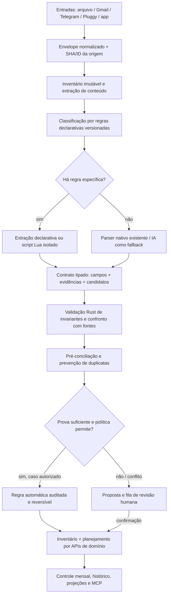

# Seu Bolso Feliz — ADR-021 / Spec 13 (PROPOSTA)
## Motor de reconhecimento, regras determinísticas e extensões Lua no Rust

**Data:** 17/11/2026  
**Estado:** proposta arquitetural para decisão e implementação incremental, não declaração de funcionalidade entregue.  
**Escopo:** núcleo local Rust, inventário, planejamento, documentos, movimentos Pluggy, MCP e futuros adaptadores de Telegram/Gmail/web.  
**Prioridade:** preservar a entrega do Controle Mensal; acrescentar extensibilidade sem reescrever o planejamento ou a conciliação.

## 1. Auditoria da base encontrada

Consultado o GitHub `ChicoFigueiredo/Seu-Bolso-Feliz` na `main`, commit `fdfedd172ee76946eb3f985ecafb64262b675574` (PR #25, mesclado em 17/11/2026).

**Implementado / com código inspecionado**:
- `crates/sbf-reconhecimento`: sequência de conferência SHA, registro, extração do texto, leitor local, IA de fallback e sugestão; a detecção local de contracheque hoje usa a expressão normalizada `demonstrativo de pagamento` e chama `sbf_planilha::contracheque::ler`.
- `crates/sbf-planilha`: leitura/importação XLSM e parser de contracheque (layouts distintos); regras específicas (por código, palavras e cabeçalhos) ficam no código Rust.
- `crates/sbf-planejamento`: projeção determinística de 360 meses a partir de recorrências, versões, exceções e conciliações, com histórico e exclusão lógica. **Não reimplementar este motor.**
- `crates/sbf-mcp`: ferramentas de consulta, simulação e proposta para planejamento; propostas aguardam confirmação na interface.
- No lado TypeScript/Neon já há `document_patterns`, `pattern_feedback`, `workers/ingestion/src/parsers/pattern-matcher.ts` e `supplier-templates`; são uma base conceitual de padrões versionados, mas **não há executor unificado de scripts Lua no Rust**.

**Evidência de entrega e limites**:
- PR #25: 92 arquivos alterados; mais de 41 mil linhas adicionadas; CI do commit de merge verde.
- A CI GitHub atual executa Bun, testes web/API, lint/typecheck e build web; **não executa `cargo test`, `cargo clippy` nem build da janela Rust**. O PR afirma 1.508 testes Rust verdes, mas essa informação não foi reexecutada nesta auditoria.
- O relatório de aceite `docs/specs/11-desktop-controle-mensal-aceite.md` ainda marca como FAIL partes de cartão × fatura × banco, histórico navegável, alerta de feriado e drill-down completo; MCP real na máquina está UNVERIFIED.
- A spec 11 registra explicitamente que **Windows foi adiado** por decisão D16; execução local Linux não comprova execução Windows.

**Conclusão auditável:** existe o pipeline e existem padrões web, mas falta um **contrato portável e executável por regras de dados e plugins de transformação**, com testes de regressão, versionamento e segurança. Não duplicar o motor de projeção nem manter dois catálogos contraditórios de padrões.

Referências: [PR #25](https://github.com/ChicoFigueiredo/Seu-Bolso-Feliz/pull/25), [reconhecimento Rust](https://github.com/ChicoFigueiredo/Seu-Bolso-Feliz/blob/main/crates/sbf-reconhecimento/src/cofre.rs), [pattern matcher](https://github.com/ChicoFigueiredo/Seu-Bolso-Feliz/blob/main/workers/ingestion/src/parsers/pattern-matcher.ts), [spec 11](https://github.com/ChicoFigueiredo/Seu-Bolso-Feliz/blob/main/docs/specs/11-desktop-controle-mensal.md), [aceite 11](https://github.com/ChicoFigueiredo/Seu-Bolso-Feliz/blob/main/docs/specs/11-desktop-controle-mensal-aceite.md).

## 2. Resultado de negócio

Qualquer observação financeira — documento enviado, anexo de e-mail, arquivo de pasta, mensagem/arquivo Telegram, transação Pluggy, fatura, comprovante, boleto, contracheque, invoice — deve ser reconhecida, normalizada e relacionada a **fatos, compromissos, serviços e movimentos** com a maior automação segura possível. O usuário só intervém em ambiguidades ou ações materiais, e essa correção retroalimenta regras testáveis. Adicionar um **novo layout simples de documento deve dispensar recompilar Rust**.

É fundamental não confundir: **documento** é evidência; **movimento** é um fato bancário; **compromisso** é uma obrigação; **ocorrência** é projeção mensal; **conciliação** é um relacionamento entre evidências; **quitação** requer prova apropriada. Receber uma fatura não significa pagá-la. Transferir entre contas não é despesa. Pagar fatura não é gastar novamente os itens do cartão.

## 3. Arquitetura proposta



### 3.1 Fronteiras dos módulos

- **`sbf-inventario`**: identidade do arquivo e das observações, proveniência, cópia preservada, texto/OCR e fatos de origem. Registro idempotente.
- **`sbf-reconhecimento`**: coordenador atual, passa a chamar `MotorDeRegras`/`Registry`; adaptar, não substituir nem reescrever.
- **Novo `sbf-regras`**: catálogo, casamento de regras declarativas, precedência, condições, ativação/versionamento, simulação, rastreamento, testes e saída tipada.
- **Novo submódulo `sbf-regras-lua` (ou feature `lua`)**: executor de scripts Lua com API restrita, limites e retornos tipados. Pode ser instalado como crate separada apenas se houver ganho real de isolamento.
- **`sbf-planejamento`**: continua autoridade sobre recorrências, versões, exceções, conciliações e projeção; recebe somente propostas/alterações válidas por sua API (`Planejamento`, `Alteracao`). Nunca chama scripts arbitrários durante a projeção de cada mês.
- **`sbf-mcp`**: ferramentas de consultar padrões, simular, testar e propor um padrão; ativação de regra ou mudança material exige aprovação na UI (e trilha de auditoria).
- **Adapters** (Gmail, Telegram, arquivo, Pluggy, web) apenas trazem envelopes para o mesmo pipeline. Não implementar um parser diferente em cada canal.
- **Web/Neon**: compartilhar o formato canônico da regra e sua identidade com `document_patterns`, evitando que padrões no servidor e no desktop se contradigam. Persistência local primeiro; sincronização futura conforme ADR-019/ADR-020.

### 3.2 Classes de tratamento

1. **Classificação**: identificar `mime`, extensão e assinatura real do arquivo, metadados de origem, texto, cabeçalho, logo/layout opcional, conta, fornecedor, período.
2. **Extração**: mapear campos (valor, vencimento, autenticação, competência, CPF mascarado, rubricas, parcelas, impostos). Preferir regras declarativas/regex/tabelas; usar Lua onde há algoritmo ou transformação específica.
3. **Normalização**: datas, moeda, unidades, fornecedores/aliases, centros, contas e vínculos; centavos inteiros.
4. **Relacionamento / pré-conciliação**: achar obrigações, lançamentos bancários e evidências correspondentes; evidenciar condições satisfeitas e divergências, com correspondência 1:1, 1:N e N:1 quando apropriado.
5. **Decisão**: gerar fatos derivados/propostas/revisões; a execução não chama SQL nem marca pago diretamente.
6. **Aprendizado supervisionado**: uma correção pode gerar sugestão de novo padrão; testar antes de publicar.

### 3.3 Contrato de entrada comum (conceitual)

```json
{
  "schema_version": 1,
  "input_id": "identificador-estavel-da-origem",
  "kind": "document|bank_transaction|email|message",
  "source": {"channel": "telegram|gmail|drag_drop|folder|pluggy", "external_id": "..."},
  "sha256": "hash-do-conteudo-quando-houver",
  "mime_detected": "application/pdf",
  "filename": "nome-seguro.pdf",
  "text": "texto-extraido-ja-normalizado",
  "visual_features": {"layout_fingerprint": null, "logo_hint": null, "colors": []},
  "hints": {"institution_id": null, "account_id": null, "amount_cents": null, "date": null},
  "evidence_refs": ["id-do-arquivo-original"],
  "event_time": "2026-11-17T10:00:00-03:00"
}
```

Observações: a imagem original e o texto completo permanecem no cofre; o envelope para um script deve conter **somente os campos necessários**. `visual_features` é opcional: cores/logotipos/layout podem ajudar, mas não provam tipo nem quitação. Identificador da origem e hash servem a deduplicação e replay. Entrada de transação Pluggy pode não ter `sha256` de arquivo; usar identificador estável da transação mais versionamento/conta, sem inventar um hash de documento.

### 3.4 Catálogo de regras (SQLite local; schema portável)

- `rules`: `id`, `name`, `rule_kind`, `owner_id`, `supplier_id?`, `institution_id?`, `document_type?`, `priority`, `specificity`, `is_active`, `created_at`.
- `rule_versions` **imutável**: `rule_id`, `version`, `language` (`json-rules` / `lua54`), `source`, `checksum`, `schema_version`, `valid_from`, `valid_to?`, `author`, `approved_by`, `activated_at?`, `disabled_at?`, `limits`, `change_reason`.
- `rule_fixtures`: entrada anonimizada, resultado esperado, casos de não aplicação, conflitos e regressão.
- `rule_executions`: identificadores de entrada e regra/versão, estágios, candidato, score, justificação, hashes dos campos de entrada relevantes, tempo, resultado e erro (sem texto sensível em log aberto).
- `rule_feedback`: aceito, corrigido, rejeitado, motivo, revisão pendente; métricas por versão.
- `rules_outbox`: propostas/ações para inventário e planejamento; idempotency key; estado; motivo de recusa.

Não é necessário criar tabelas duplicadas se as já existentes em `document_patterns`/`pattern_feedback` e no SQLite local puderem ser estendidas: primeiro produzir mapeamento explícito entre os esquemas. O **formato canônico versionado é mais importante que o nome de uma tabela**.

### 3.5 Precedência, determinismo e provas

- Reconhecimento por **tipo real de conteúdo** (magic/MIME), contexto de origem e texto; apenas usar extensão é insuficiente.
- Ordem: regra com fornecedor/instituição/tipo e assinatura específica > regra de tipo geral > leitor nativo > IA assistida; resultado sempre passa por validadores Rust.
- Em empate ou contradição em campos críticos (valor, conta, data, contrato, autenticação), não arbitrar silenciosamente: **revisão humana**.
- Mesmo par `(entrada normalizada, regra versionada, parâmetros versionados)` deve gerar a mesma saída, exceto campos explicitamente não determinísticos que não podem decidir pagamento.
- Cada campo extraído informa valor, origem (página/trecho ou campo da Pluggy), regra/versão, confiança e eventuais conflitos.
- Confiança não substitui prova: **auto-conciliação somente se uma política tipada e explicitamente autorizada comprovar as condições**; manter a exceção atual de três provas para salário, reversível. Nada de auto-pagamento ou cancelamento em fornecedor.
- Reprocessar a mesma entrada não cria fato, obrigação, parcela, pagamento ou proposta duplicada. Replay com nova versão da regra é simulação prévia e só altera registros derivados após confirmação/autorização.

## 4. Lua: quando usar e como executar

**Lua também é determinístico**, se receber os mesmos dados/parâmetros, não acessar estado externo e não tiver efeitos colaterais. O valor de Lua é permitir **código curto configurável sem recompilar Rust**, para cálculo, condicionais e exceções de layout.

**Usar Lua para**: calcular campos derivados; reconstituir competências e códigos de rubricas; interpretar linhas de comprovantes com formato conhecido; converter unidades; aplicar tabela de cálculo versionada; definir campos candidatos e justificativas.

**Não usar Lua para**: acesso direto a SQLite/Neon; ler arquivos arbitrários; acessar internet/Gmail/Telegram; mudar saldo, lançar pagamento, marcar conta como quitada; disparar outra regra fora do contrato; criar código autoexecutável com base em texto de documento.

### 4.1 Runtime sugerido

- Integrar Rust à linguagem por `mlua` com Lua 5.4 (ou comparar `luau` caso a segurança dos scripts não confiáveis seja prioridade máxima). **No `mlua`, `Lua::sandbox(true)` é recurso de `luau`, não de Lua 5.4**; em Lua 5.4 exige ambiente restrito construído pelo host.
- Para scripts escritos pela IA ou importados, considerar sempre **não confiável**: processo auxiliar isolado com permissão mínima, sem acesso à rede/arquivos/secrets e com encerramento por timeout; ambiente/VM sem `io`, `os`, `package`, `debug`, `dofile`, `loadfile`, FFI e bytecode externo.
- Limites por execução de memória, instruções, profundidade e tempo; cancelamento; tamanho máximo do JSON de entrada/saída; nenhuma saída direta para logs de conteúdo. `mlua` expõe limites de memória e hooks de instruções para Lua 5.4; não confundir esses limites com garantia de isolamento de sistema operacional.
- Executar somente **fonte** aprovada; identificar o script por versão+SHA e auditar cada execução. Scripts em estado `draft` nunca rodam na ingestão de produção.
- Não confiar nos números de ponto flutuante para dinheiro: **entrada/saída em centavos inteiros** e funções puras do host para arredondamento inteiro, com testes em fronteiras, percentuais e faixas.
- A API de script expõe objetos somente leitura, como `input`, `params`, `helpers`, e espera retorno tipado `DecisionCandidate`; o Rust valida campos e invariantes.

Docs runtime: https://docs.rs/mlua/latest/mlua/struct.Lua.html , https://luau.org/sandbox/

### 4.2 Exemplo de script Lua: cálculo de conferência de IRRF (ilustrativo)

Este script **não define alíquotas reais**. O conjunto legal de faixas e deduções, com vigência e fonte, é entregue por `params.irrf` a partir de uma tabela aprovada. A rubrica do contracheque é fato documental; o script calcula **estimativa para conferir**, não substitui o imposto retido mostrado no documento.

```lua
function transform(input, params, helpers)
  if input.document_type ~= "contracheque" then
    return {matched = false}
  end
  local base = math.max(0, input.base_tributavel_cents or 0)
  local faixa = nil
  for _, item in ipairs(params.irrf.faixas) do
    if base <= item.teto_cents then
      faixa = item
      break
    end
  end
  if faixa == nil then
    return {matched = true, needs_review = true, reason = "tabela de IRRF sem faixa aplicavel"}
  end
  local estimado = math.max(0, helpers.mul_div_round(base, faixa.aliquota_ppm, 1000000) - faixa.parcela_deduzir_cents)
  return {
    matched = true,
    document_type = "contracheque",
    derived_fields = {irrf_estimado_cents = estimado},
    needs_review = (input.irrf_retido_cents ~= nil and input.irrf_retido_cents ~= estimado),
    evidence = {"rubrica_irrf", "tabela_irrf:" .. params.irrf.versao}
  }
end
```

A base tributável e o cálculo de IRRF são mais complexos que subtrair descontos genéricos: **nunca inferir base ou legislação sem dados e tabela corretos**. Testar a validade legal por competência, dependentes, deduções, isenções e regras especiais; não misturar cálculo de retenção mensal com imposto anual.

### 4.3 Editor e ciclo de vida

1. A IA ou usuário propõe padrão/pequeno script com nome, condição de detecção, transformações, entradas/saídas, exemplos e motivo.
2. Validar sintaxe e assinatura, negar APIs proibidas e executar **apenas em sandbox** contra fixtures privadas anonimizadas e casos adversariais.
3. Simular em lote contra histórico em modo somente leitura, produzindo diff (antes/depois, divergências e novos candidatos). Não modificar livros/compromissos no teste.
4. Exigir confirmação do usuário para ativar nova versão; liberar rollout gradual (só leitura/sugestão primeiro); rollback em um clique preservando todas as versões.
5. Detectar taxa de erro/feedback negativo, desativar versão problemática sem excluir evidências antigas.
6. Manter painel: regras ativas, qual tipo tratam, versão, origem, últimas execuções, taxa de acerto, última revisão, exemplos e botão **Testar com este documento**.

## 5. Três jornadas críticas

**A. Contracheque CAIXA**: arquivo PDF → texto → detector CAIXA/contracheque → leitor já existente (sem substituição) → campos/rubricas → Lua *opcional* calcula conferências (como IRRF conforme tabelas versionadas) → sugere vínculo de cada rubrica com compromissos/consignados → concilia salário automaticamente somente pela política das três provas; divergências em revisão.

**B. Comprovante CAIXA recebido do Telegram**: bot/adaptador autorizado recebe mídia e identificadores da mensagem → arquivo preservado no cofre → detector tipado vê sinais do comprovante → regra por layout extrai valor, data, conta, destinatário, autenticação → encontra candidatos no inventário, Pluggy, faturas e Controle Mensal → propõe relações comprovante–movimento–obrigação, sem confundir comprovante com novo gasto → em conflito/ausência de prova, solicitar revisão e aprender com a correção. Telegram não deve executar scripts fornecidos na mensagem.

**C. Fatura cartão / invoice OpenAI ou Anthropic**: detector tipo/fornecedor, extração de itens e total (preservando documento) → vincula serviço/assinatura/categoria/centro → confronta fatura, transação do cartão e pagamento bancário → **não triplica o gasto**. Itens sem comprovação exata ficam como candidatos.

## 6. Modo de falha / riscos

- Um logo ou paleta de cores não é identificação segura do emissor; usar como sinal secundário, com texto e dados verificáveis.
- PDFs e e-mails podem conter instruções maliciosas em linguagem natural; nunca elevá-las a código executável ou instruções de agente.
- Cálculos tributários exigem tabelas válidas por competência e revisão técnica; script corrigível, mas **não deve autoalterar IR real sem aprovação**.
- Um script errado não deve bloquear toda a fila: registrar o erro, isolar o item e continuar; falha sem texto vai a OCR/IA/revisão.
- Previsto/pago, compras/fatura/pagamento, salário bruto/líquido/descontos, empréstimo principal/juros precisam de invariantes fixas em Rust, não alteráveis pelo Lua.
- Centralizar scripts em banco compartilhado pode expor dados a web/IA; padrão local/cofre e política explícita de confiança são preferíveis. Nenhum PDF real, CPF, conta ou invoice deve entrar no repositório, fixtures ou logs.

## 7. Fases de implementação — sem interromper o Controle Mensal

### P0 — Contrato + motor declarativo (bloqueio de arquitetura)
- ADR aprovada; esquemas de entrada/saída e catálogo canônico mapeado ao `document_patterns` já existente.
- Injetar `MotorDeRegras` no passo `LerLocalmente` do `sbf-reconhecimento`, sem mexer nas APIs financeiras.
- Carregar regra de SQLite, rodar detecção e extração por dados, com trace, versionamento, precedência, simulação e fallback dos parsers existentes.
- Demonstração obrigatória: cadastrar um tipo de comprovante fictício por configuração, reconhecer documento **sem recompilar Rust**.

### P1 — Executor Lua (feature isolada)
- `mlua` com VM restrita, subprocesso para scripts não confiáveis, limites, API de valores imutáveis, sem IO, rede, SQL ou mutações.
- Ativação e rollback; testes de segurança e precisão de centavos.
- Demonstração: alterar Lua de uma regra e obter extração/cálculo diferente em um documento fictício **sem build**; documentação de como criar regra.

### P2 — Pré-conciliação + interfaces
- Resultado dos scripts vira apenas `DecisionCandidate`; confronto com Pluggy, compromissos, contratos, faturas e comprovantes; política Rust valida e aplica via API/propõe na interface.
- Janela: catálogo e editor seguro, teste, diff, simulação histórica e confirmação; MCP: listar/explicar/simular/propor padrão, **não ativar sozinho**.

### P3 — Novos adaptadores e cálculo específico
- Telegram/Gmail como origens, mesma máquina de estados, dedup e segredo da integração no cofre.
- Biblioteca de regras por comprovantes bancários/contracheques/faturas/invoices, com fixtures.
- IRRF calculado por script contra tabela **versionada por competência**, inicialmente só conferência.

## 8. Critérios de aceite (contrato de auditoria)

- **AC-LUA-01**: incluir tipo documental novo por `rule_version` ativa em SQLite e reconhecer após reload, sem alteração/recompilação Rust.
- **AC-LUA-02**: novo layout de comprovante CAIXA por regra específica supera classificador geral, com trilha do porquê; alteração de layout não afeta tipos antigos.
- **AC-LUA-03**: duas regras em conflito **não escrevem**: resultado sinaliza ambiguidade, motivo e candidatos.
- **AC-LUA-04**: mesmo envelope + mesma regra/versão + mesmos parâmetros geram exatamente o mesmo output, bytes/idempotency keys estáveis.
- **AC-LUA-05**: executar Lua sem `io/os/package/debug`, sem acesso à rede, arquivos/SQL, com limite de tempo, memória e instruções; scripts maliciosos/loop infinito não travam o app nem a fila.
- **AC-LUA-06**: Lua nunca consegue marcar pago nem criar lançamento diretamente; alterações passam por validação Rust e políticas de confirmação/autoaplicação.
- **AC-LUA-07**: editor salva rascunho e prova sintaxe/testes/diff; IA não publica regra nem executa código sugerido automaticamente; rollback conserva histórico.
- **AC-LUA-08**: cada campo e associação rastreáveis a origem, trecho/página, regra e versão; nenhuma evidência derivada é inventada.
- **AC-LUA-09**: documento repetido em Telegram e pasta é reconhecido uma vez e acumula origens; evento Pluggy não duplica pagamento.
- **AC-LUA-10**: nenhuma dupla contagem entre itens do cartão, total da fatura e débito; contracheque líquido e desconto em folha não reduzem caixa duas vezes.
- **AC-LUA-11**: IRRF estimado indica tabela/competência/versão e alerta divergência, sem sobrescrever rubrica do contracheque.
- **AC-LUA-12**: testes de unidade e integração executados para crates Rust; `cargo fmt --check`, `cargo clippy --workspace --all-targets -- -D warnings`, `cargo test --workspace` e build da UI Linux documentados; adicionar essas verificações à CI em job Rust.
- **AC-LUA-13**: Teste real contra *cópia* do cofre, com contagens e discrepâncias, sem expor dados na saída; auditor confirma evidências e a UI, não apenas relato do implementador.
- **AC-LUA-14**: o controle mensal de 360 meses, pausas e reconciliações existentes continua igual com e sem a feature de regras Lua (testes de regressão).

## 9. Orientação aos agentes

1. **Não iniciar refatoração geral.** Primeiro produzir ADR e contrato preciso para entrada, saída e persistência; compatibilizar a modelagem web `document_patterns` e o novo `sbf-regras` local.
2. Separar ownership: agente A — contrato/SQLite; agente B — executor e sandbox em crate isolada; agente C — testes/fixture e integração mínima. Não editar o mesmo arquivo em worktrees concorrentes.
3. Congelar API do motor antes de implementar UI/MCP. Testes de comportamento e de segurança primeiro; compare com spec 11/12 para garantir não regressão.
4. Demos: comprovante reconhecido só por JSON; transformação Lua sem build; comprovante e Pluggy gerando única pré-conciliação; desconhecido indo para revisão.
5. Entregar diff, `cargo` checks, prints/capturas com dados fictícios, passos de ativação/rollback e matriz AC-LUA com links para evidências. Um agente independente fará o aceite.

**Condição de parada:** AC-LUA-01 a AC-LUA-14 verificadas com testes e ensaio de interface; nenhuma regressão relevante em inventário, planejamento ou fluxo de três provas. Se houver ambiguidade em permitir autoaplicação, escolher **somente sugestão** até decisão formal.
